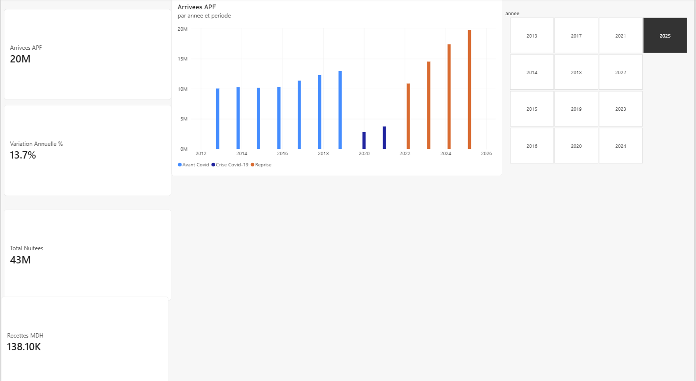
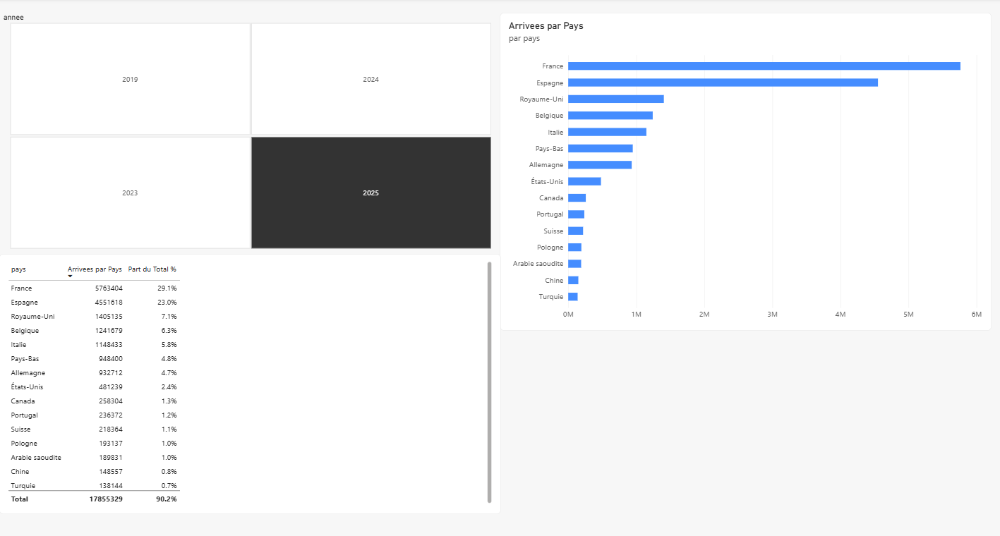
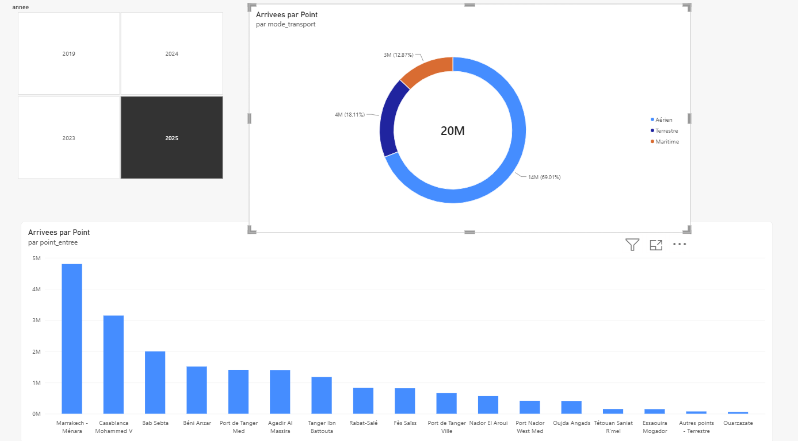
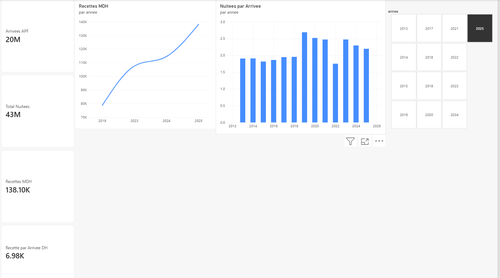

# Analyse du tourisme au Maroc (2019-2025)

Pipeline de nettoyage en **Python (pandas)** et tableau de bord interactif **Power BI** à partir de statistiques officielles sur les arrivées de touristes, les nuitées et les recettes de voyages.

## Objectif

Transformer trois fichiers Excel mis en forme comme des rapports (titres, totaux, sous-totaux, colonnes calculées) en tables exploitables, puis répondre à quatre questions :

1. Le tourisme marocain a-t-il dépassé son niveau d'avant la crise Covid-19 ?
2. De quels pays viennent les touristes, et quels marchés progressent le plus vite ?
3. Par quels modes de transport et quels points d'entrée arrivent-ils ?
4. Les recettes et les nuitées suivent-elles la croissance des arrivées ?

## Données

| Fichier | Contenu | Années |
|---|---|---|
| `Indicateurs-touristiques-2025.xlsx` | Arrivées aux postes frontières (APF), nuitées dans les établissements d'hébergement touristique classés (EHTC), recettes voyages (millions de DH) | 2013-2025 (recettes : 2019, 2023, 2024, 2025) |
| `Evolution_nationalite_PF-2025.xlsx` | Arrivées par nationalité | 2019, 2023, 2024, 2025 |
| `Tourisme-PF-2025.xlsx` | Arrivées par mode de transport et point d'entrée | 2019, 2023, 2024, 2025 |

**Source :** _à compléter (organisme émetteur et lien de téléchargement)_.**Source :** ministère du Tourisme, de l'Artisanat et de l'Économie sociale et solidaire (Maroc), rubrique [Chiffres clés](https://mtaess.gov.ma/fr/chiffres-cles/). Fichiers téléchargés en 2026.

## Pipeline de données

Scripts dans `src/`, à exécuter dans cet ordre :

| Script | Rôle |
|---|---|
| `clean_nationalite.py` | Retire titres et ligne Total, passe au format long, harmonise les noms de pays |
| `clean_point_entree.py` | Repère le mode de transport de chaque ligne, retire les sous-totaux, passe au format long |
| `clean_indicateurs.py` | Extrait trois petits tableaux empilés dans une même feuille et les fusionne en une ligne par année |
| `create_dim_annee.py` | Crée la dimension année avec la période (avant Covid, crise Covid-19, reprise) |

Les tables propres sont écrites dans `data/clean/` (CSV en UTF-8).

### Contrôles qualité

- Le total des arrivées par point d'entrée retombe sur le total officiel pour chaque année (19 792 594 en 2025).
- Le total par nationalité est identique dans les deux fichiers sources.
- Les sous-totaux (T.AIR, T.MER, T.TERRE, Total) sont exclus des tables de faits pour éviter tout double comptage.

### Écart détecté et traitement

La somme des points d'entrée listés est inférieure au total officiel de 208 000 à 280 000 arrivées selon l'année : le fichier ne détaille pas les petits points d'entrée. Une ligne « Autres points - Aérien / Maritime / Terrestre » (sous-total moins détail) a été ajoutée pour que le détail se réconcilie exactement avec le total.

## Modèle de données (schéma en étoile)

`dim_annee` est reliée aux trois tables de faits par la colonne `annee` :

- `fact_indicateurs_annuels` (arrivées, nuitées, recettes)
- `fact_nationalite` (pays x année)
- `fact_point_entree` (mode de transport x point d'entrée x année)

## Tableau de bord Power BI

Fichier : `powerbi/tourisme_maroc.pbix`.

### 1. Vue d'ensemble


### 2. Marchés émetteurs


### 3. Points d'entrée


### 4. Performance économique


## Résultats clés

- **19,79 M** d'arrivées en 2025 (+13,7 % par rapport à 2024), contre 12,93 M en 2019 (+53 %).
- La crise Covid-19 a fait chuter les arrivées à 2,78 M en 2020 (-78,5 %).
- La France (29,1 %) et l'Espagne (23,0 %) représentent plus de la moitié des arrivées.
- En 2025, parmi les pays listés, les plus fortes hausses par rapport à 2024 sont la Chine (+39,5 %), le Canada (+28,6 %), la Pologne (+26,3 %) et l'Italie (+20,7 %).
- Le transport aérien assure 69,0 % des arrivées, devant le terrestre (18,1 %) et le maritime (12,9 %). Marrakech-Ménara est le premier point d'entrée (4,80 M).
- Les recettes de voyages atteignent 138 101 millions de DH en 2025, contre 78 747 millions en 2019, soit environ 6 977 DH par arrivée en 2025.

## Limites des données

- Les nationalités, les points d'entrée et les recettes n'existent que pour 2019, 2023, 2024 et 2025 : aucune tendance continue n'est affichée pour 2020-2022.
- La ligne « Autres » du fichier des nationalités est un regroupement de petits marchés, pas un pays : elle est exclue du classement. Les parts en pourcentage restent calculées sur le total de toutes les arrivées, d'où le total de 90,2 % dans le tableau des pays.
- Les nuitées des EHTC et les arrivées aux frontières ne couvrent pas exactement le même périmètre : le ratio « nuitées par arrivée » est un indicateur approximatif et non une durée réelle de séjour.
- Les nuitées passent de 24,0 M en 2018 à 34,7 M en 2019 (+44,7 %) alors que les arrivées progressent de 5,2 % : cette rupture est à vérifier auprès de la source (changement de méthode possible, non confirmé).
- Les recettes sont exprimées en millions de DH courants, sans correction de l'inflation.

## Reproduire le projet

```powershell
python -m venv venv
venv\Scripts\activate
pip install -r requirements.txt
python src/clean_nationalite.py
python src/clean_point_entree.py
python src/clean_indicateurs.py
python src/create_dim_annee.py
```

Placez les trois fichiers Excel dans `data/raw/` avant de lancer les scripts, puis ouvrez le fichier Power BI et actualisez les données.

## Compétences mises en oeuvre

Nettoyage et transformation de données (pandas), contrôle qualité et réconciliation de totaux, modélisation en étoile, mesures DAX, visualisation et conception d'un tableau de bord interactif, versionnement Git.
